<p align="center">
  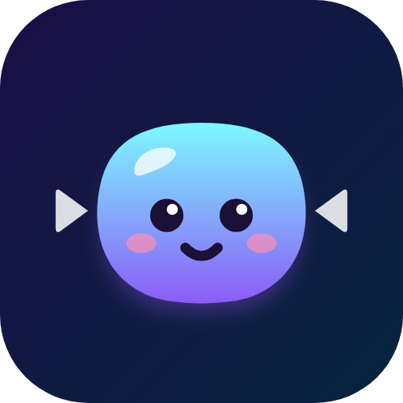
</p>

<h1 align="center">Squishy</h1>

<p align="center">
  <b>Big videos in. Tiny videos out.</b><br>
  A video compressor for Android 16+ that keeps going in the background,
  cleans up after itself, and looks good doing it.
</p>

<p align="center">
  
  
  
</p>

> **Vibecoded.** Squishy was designed and written by an AI coding assistant
> (Claude, by Anthropic), directed by me (Tomas): I described what I wanted,
> made the decisions, and tested it; the AI wrote the code.

<p align="center">
  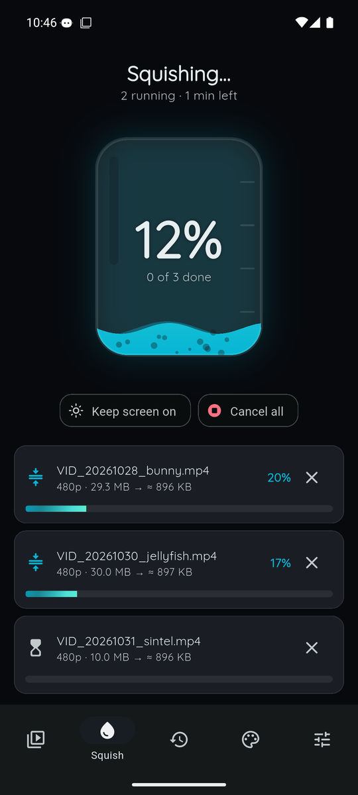
  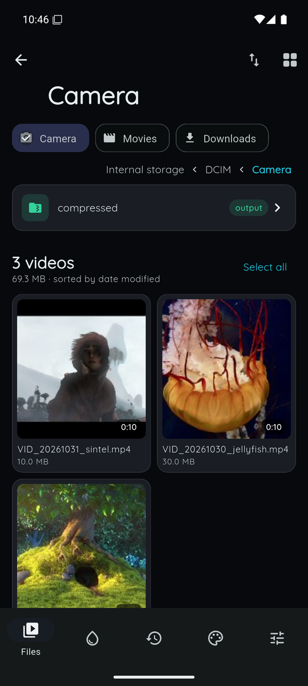
  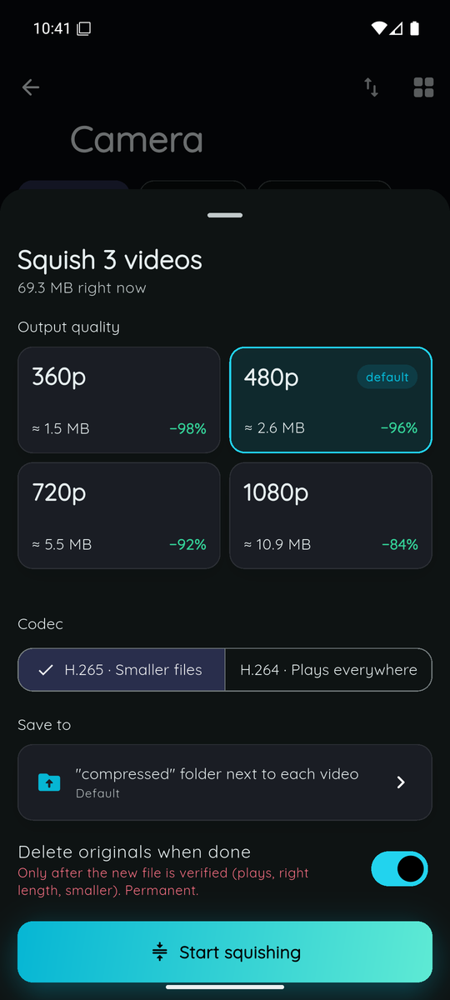
</p>

## What it does

- **Compresses whole folders.** Pick one video or fifty, then choose 360p, **480p** (default),
  720p or 1080p. Every option shows the **expected file size** and how much you'll save
  before you start.
- **Keeps working in the background.** Squishy runs as a foreground service with a wake lock.
  It keeps going when you switch apps, turn the screen off or swipe it out of Recents. If
  Android ever kills it, it resumes the queue by itself.
- **Keeps the screen on if you want.** One tap on the progress screen keeps the display awake
  while it works.
- **Deletes originals for you, safely.** An original is removed only after the new file
  has been checked: it plays, has the right length, and is actually smaller. If anything
  looks wrong, the original stays and the job is logged as failed with the reason.
- **Saves where you want.** By default each video goes into a `compressed` folder next to
  the original. You can also pick (or create) any other folder.
- **Runs several videos at once.** 1, 2 (default) or 3 videos at the same time, or one
  after another.
- **Cuts & joins.** Mark as many segments of a video as you like, reorder them, preview them,
  and Squishy joins them into one clean file. The original is kept.
- **Browses your whole phone.** A real folder browser with shortcuts to Camera, Screen
  recordings, Movies, Downloads, WhatsApp and Telegram.
- **Sorts however you like:** by name, date, size, duration or resolution, ascending or descending.
- **Shows videos however you like:** grid, big cards, list, or compact.
- **Keeps a history.** Every squished and failed video is logged, with stats and charts of the
  space you've saved.
- **Lets you change the look.** Pick a theme, progress animation, chart style, file view,
  font and corner shape, each shown as a live preview card.

## Screenshots

| Welcome | Permissions | Squishing | Done |
|:---:|:---:|:---:|:---:|
| 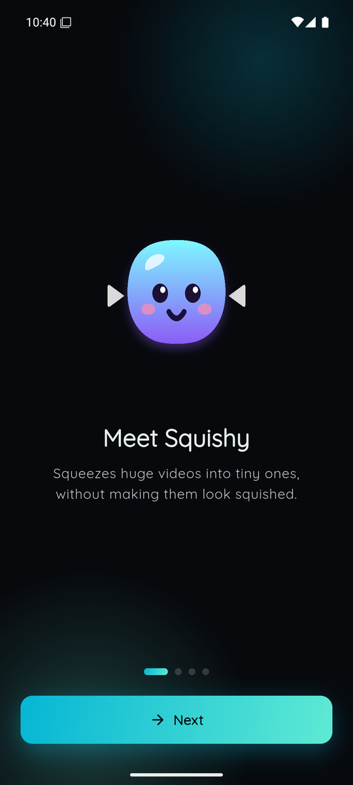 | 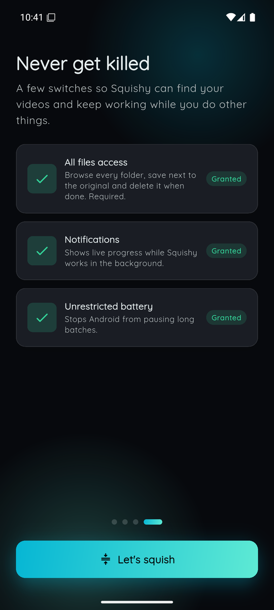 |  | 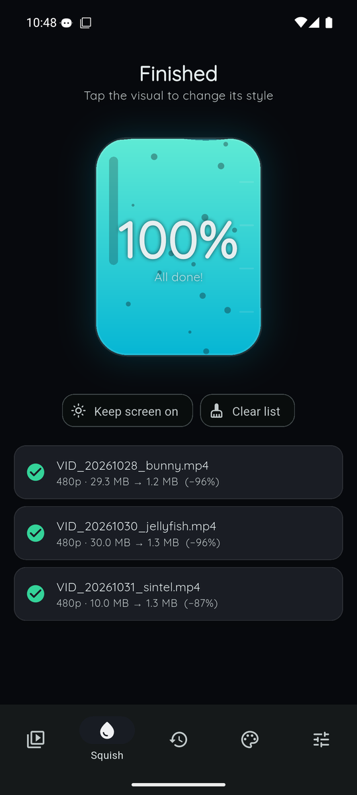 |

| Cut & join | Background notification | Stats | Settings |
|:---:|:---:|:---:|:---:|
| 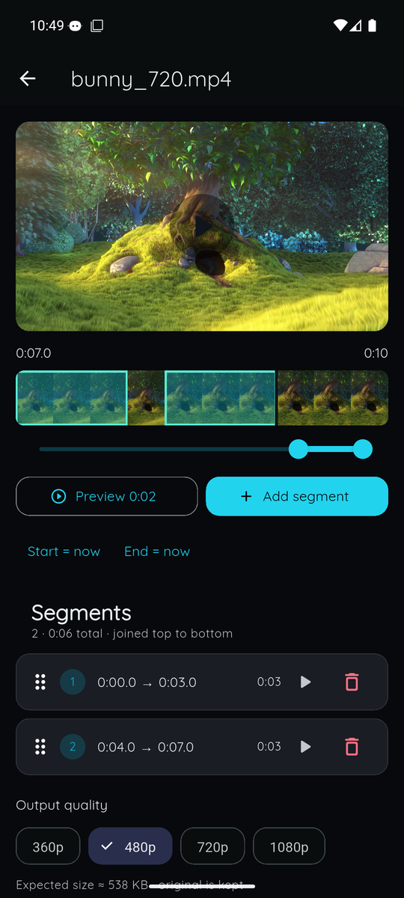 | 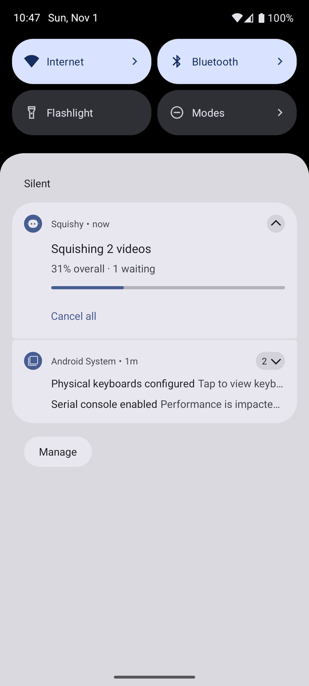 | 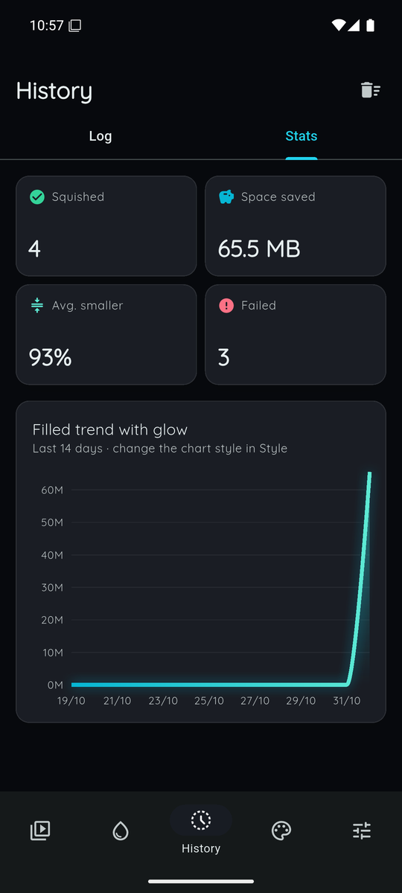 | 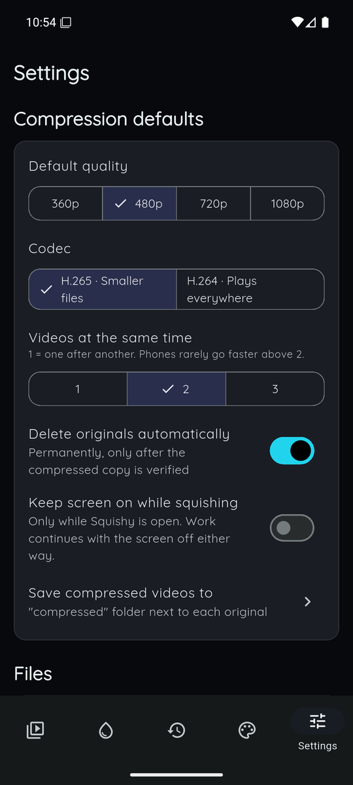 |

**Personalization:** themes, progress animations and chart styles, each previewed live.

| Themes | Progress animations | Chart styles | Midnight Violet theme |
|:---:|:---:|:---:|:---:|
| 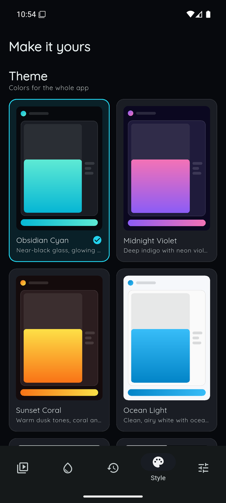 | 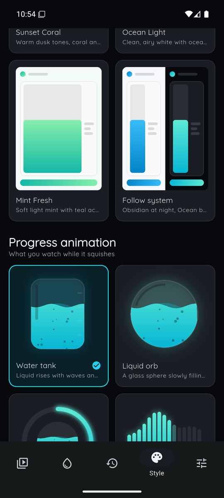 | 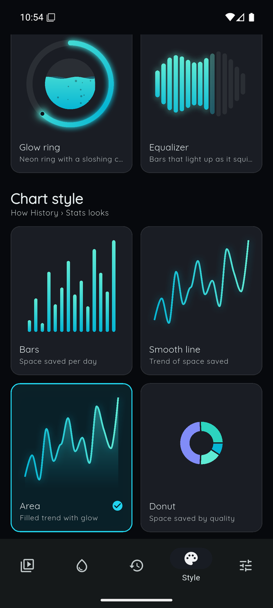 | 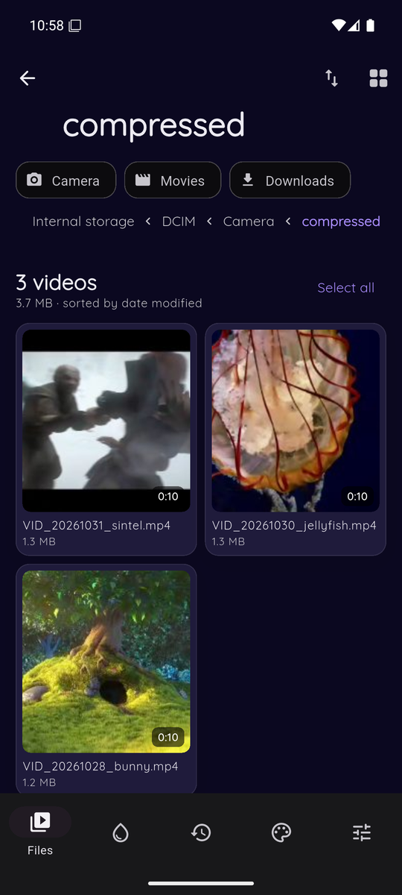 |

## Install

1. Download the latest `Squishy-vX.Y.Z.apk` from **[Releases](../../releases)**.
2. Open it on your phone and allow installing from that source when Android asks.
3. Open Squishy and follow the welcome tour. It asks for:
   - **All files access** (required) to browse folders and replace originals.
   - **Notifications** to show progress while it works in the background.
   - **Unrestricted battery** so Android doesn't pause long batches.

> Upgrading from Squishy 1.x? Uninstall the old version first. 2.0 is a new app signed with a new key.

### Xiaomi / Redmi / POCO (HyperOS, MIUI)

Xiaomi phones are very aggressive about closing background apps. On these phones the
welcome screen shows two extra buttons. Use both:

1. **Autostart** → turn Squishy **on**.
2. **Battery saver** → choose **No restrictions**.
3. Optional but recommended: open Recents and **lock** Squishy (pull its card down or tap the lock).

You can come back to these any time in **Settings → Background reliability**.

## How to use

1. **Files** tab: browse to a folder (or tap a shortcut). Tap a video for options, or
   long-press / **Select all** to pick several.
2. Tap **Squish**, choose the quality (the expected size is shown), and tap **Start squishing**.
3. Watch the **Squish** tab fill up, or just leave. A notification shows progress, and you
   get another one when the batch is done.
4. To keep only parts of a video, tap it and choose **Cut segments**. Drag the slider,
   tap **Add segment**, repeat, then **Cut & join**.
5. **History** shows what worked, what failed and why. **Style** changes the look.

### Good to know

- Output files are MP4 (H.265 by default, or H.264 for maximum compatibility).
- Squishy never upscales: a 360p video stays 360p even if you choose 1080p.
- If a compressed file wouldn't be smaller than the original (some videos are already small),
  Squishy keeps the original and logs it as "No size gain".
- HDR phone videos are converted to standard colors so they play everywhere.
- Everything happens on your phone. Squishy never uploads your videos. The only internet
  access is to download the fonts.

## Under the hood

- **Flutter** UI with **FlexColorScheme** theming and **flutter_animate** motion. The
  progress animations are custom-painted.
- A **native Kotlin engine** using **Media3 Transformer** (hardware encoders, clipping and
  joining), driven by a `specialUse` foreground service with a saved queue.
- Details and design decisions: [PROJECT.md](PROJECT.md). Version history: [CHANGELOG.md](CHANGELOG.md).

## Building

Requires Flutter 3.47+, JDK 17 and the Android SDK (platform 36).

```bash
flutter pub get
flutter analyze
flutter test
flutter build apk --release
```

Release builds are signed with the key described in `android/key.properties`, which is
gitignored and kept outside the repo. Without that file the build falls back to the debug key.

## Credits

- The videos in the screenshots are open-movie clips: *Big Buck Bunny* and *Sintel*
  (© Blender Foundation, CC BY 3.0) and *Jellyfish* (test footage by jell.yfish.us),
  via test-videos.co.uk.
- Squishy the mascot was drawn in code, like everything else here.
